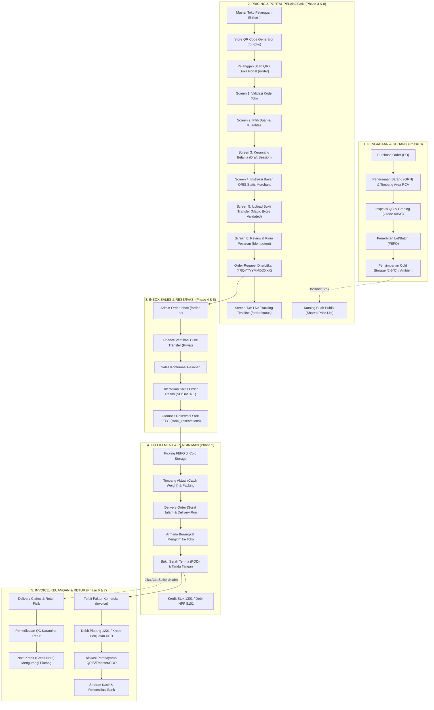

# LAPORAN KOMPREHENSIF END-TO-END FLOW & POSTUR KEAMANAN
## Fresh Distribution Business OS Bekasi (Phase 1 — Phase 8)
**Dokumen Referensi Resmi & Audit Arsitektur Sistem**  
*Tanggal Pembaruan: 21 Oktober 2026*  
*Status Sistem: Siap Produksi (Production-Ready) — 133/133 Automated Tests Passing (100%)*

---

## DAFTAR ISI
1. [Ringkasan Eksekutif & Status Sistem Terkini](#1-ringkasan-eksekutif--status-sistem-terkini)
2. [Arsitektur Fondasi & Prinsip Desain (Phase 1)](#2-arsitektur-fondasi--prinsip-desain-phase-1)
3. [Alur Bisnis End-to-End Terintegrasi (Phase 2 s/d Phase 8)](#3-alur-bisnis-end-to-end-terintegrasi-phase-2-sd-phase-8)
   - [3.1. Pengadaan Buah, Penerimaan, QC & Batching (Phase 3)](#31-pengadaan-buah-penerimaan-qc--batching-phase-3)
   - [3.2. Manajemen Inventaris, Cold Storage & FEFO Ledger (Phase 3 & 5)](#32-manajemen-inventaris-cold-storage--fefo-ledger-phase-3--5)
   - [3.3. Pricing, CRM, Customer Store Code & QR Portal (Phase 4 & 8)](#33-pricing-crm-customer-store-code--qr-portal-phase-4--8)
   - [3.4. Pemesanan Mandiri Pelanggan (Customer Journey Screen 1–8) (Phase 8)](#34-pemesanan-mandiri-pelanggan-customer-journey-screen-18-phase-8)
   - [3.5. Inbox Admin, Verifikasi Pembayaran & Konversi Sales Order (Phase 4 & 8)](#35-inbox-admin-verifikasi-pembayaran--konversi-sales-order-phase-4--8)
   - [3.6. Fulfillment, Timbang Aktual, Delivery Run & POD (Phase 5)](#36-fulfillment-timbang-aktual-delivery-run--pod-phase-5)
   - [3.7. Invoicing, Piutang (AR), Payment Allocation & Kasir Settlement (Phase 6)](#37-invoicing-piutang-ar-payment-allocation--kasir-settlement-phase-6)
   - [3.8. Klaim Pengiriman, Retur Buah Fisik & QC Karantina (Phase 7)](#38-klaim-pengiriman-retur-buah-fisik--qc-karantina-phase-7)
   - [3.9. Double-Entry General Ledger (GL) & Tutup Buku Otomatis](#39-double-entry-general-ledger-gl--tutup-buku-otomatis)
4. [Diagram Alur Operasional End-to-End (Mermaid Workflow)](#4-diagram-alur-operasional-end-to-end-mermaid-workflow)
5. [Audit & Postur Keamanan Mendalam (Security Hardening)](#5-audit--postur-keamanan-mendalam-security-hardening)
   - [5.1. Autentikasi, Manajemen Sesi & Proteksi Akun](#51-autentikasi-manajemen-sesi--proteksi-akun)
   - [5.2. Role-Based Access Control (RBAC) & Isolasi Multi-Gudang](#52-role-based-access-control-rbac--isolasi-multi-gudang)
   - [5.3. Perlindungan Terhadap Manipulasi Finansial & Data Klien](#53-perlindungan-terhadap-manipulasi-finansial--data-klien)
   - [5.4. Keamanan Unggah Bukti Bayar & Anti-Path Traversal](#54-keamanan-unggah-bukti-bayar--anti-path-traversal)
   - [5.5. Pencegahan IDOR & Anti-Enumerasi Toko](#55-pencegahan-idor--anti-enumerasi-toko)
   - [5.6. Idempotency Guard & Penanganan Konkurensi Database](#56-idempotency-guard--penanganan-konkurensi-database)
   - [5.7. Immutability Ledger & Audit Trail Terisolasi](#57-immutability-ledger--audit-trail-terisolasi)
   - [5.8. Keamanan Lingkungan Pengujian & Kebijakan Costing Gate](#58-keamanan-lingkungan-pengujian--kebijakan-costing-gate)
6. [Matriks Skema Basis Data & Migrasi (0000–0006)](#6-matriks-skema-basis-data--migrasi-00000006)
7. [Hasil Verifikasi & Bukti Pengujian Otomatis](#7-hasil-verifikasi--bukti-pengujian-otomatis)
8. [Panduan Operasional & Backup/Disaster Recovery](#8-panduan-operasional--backupdisaster-recovery)

---

## 1. Ringkasan Eksekutif & Status Sistem Terkini

**Fresh Distribution Business OS Bekasi** adalah sistem operasi bisnis terintegrasi (*end-to-end ERP/BOS*) yang dirancang khusus untuk menangani kompleksitas operasional distribusi buah segar di wilayah Bekasi dan sekitarnya. Sistem ini mencakup seluruh rantai pasok mulai dari pengadaan langsung dari petani/kebun, inspeksi kualitas penerimaan (QC & grading A/B/C), penyimpanan dingin (Cold Storage), manajemen persediaan FEFO (*First Expired, First Out*), penyusutan buah, penetapan harga berjenjang, pemesanan mandiri pelanggan via QR Code, kontrol kredit pelanggan, pemenuhan pesanan dengan penimbangan aktual (*catch weight*), pengiriman kurir berbasis rute, bukti terima (POD), faktur komersial, buku besar piutang (AR), setoran kasir/bank, penyelesaian klaim/retur, hingga jurnal pembukuan berpasangan (*double-entry GL*).

### Indikator Mutu & Baseline Repositori:
- **Linting:** `0 warning`, `0 error` via ESLint.
- **Type Safety:** `0 error` via TypeScript compiler (`tsc --noEmit`).
- **Pengujian Otomatis (Vitest):** **10/10 test files lulus (133/133 skenario pengujian, tingkat kelulusan 100%)**.
- **Kompilasi Produksi Next.js:** Berhasil mengompilasi **28 rute** (13 rute statis dan 15 rute dinamis/API) dengan `exit code 0`.
- **Database:** PostgreSQL 14.19 dengan Drizzle ORM. 7 berkas migrasi (`0000_init` hingga `0006_blue_betty_ross`) telah diaplikasikan ke database development (`buah_dev`) dan database testing (`buah_test`).

---

## 2. Arsitektur Fondasi & Prinsip Desain (Phase 1)

### 2.1. Standar Stack Teknologi
- **Framework Aplikasi:** Next.js 16 (App Router) dengan React 19.
- **Bahasa Pemrograman:** TypeScript 5+ (Strict Mode diaktifkan, melarang `any` implisit).
- **ORM & Basis Data:** Drizzle ORM berjalan di atas PostgreSQL 14/16 dengan konektor `node-postgres` (`pg`).
- **Sistem Autentikasi:** Better Auth dengan session token terenkripsi, penyimpanan sesi berbasis database, dan proteksi multi-faktor.
- **Desain UI:** Tailwind CSS v4, Lucide React Icons, Enterprise SaaS Design System (Sidebar, Status Pill, Modal Dialogs, Responsive Tables, Mobile-First Customer View).
- **Presisi Numerik Finansial:** Menggunakan `decimal.js` (dibungkus dalam `MoneyDecimal`) untuk seluruh operasi mata uang dan kuantitas. **Dilarang keras menggunakan floating-point native JavaScript** untuk data uang atau stok.

### 2.2. Invarian Domain Bisnis Wajib
1. **Presisi Finansial:**
   - Mata uang tunggal Rupiah (IDR).
   - Nilai moneter disimpan sebagai `numeric(15, 2)` pada basis data.
   - Harga satuan disimpan sebagai `numeric(12, 4)` untuk mengakomodasi perhitungan per gram atau per UoM kecil.
   - Pembulatan Rupiah menerapkan *round half up* ke satuan Rupiah terdekat tanpa sen (`roundRupiah`).
2. **Presisi Kuantitas & Konversi UoM:**
   - Kuantitas dasar disimpan sebagai `numeric(12, 3)` (presisi hingga gram / 0.001 kg).
   - Seluruh pergerakan stok dikonversi ke satuan dasar (*base UoM*, umumnya kilogram).
3. **Pemisahan Kewenangan (Separation of Duties):**
   - Staf gudang tidak dapat menyetujui penyesuaian stok bernilai besar.
   - Driver/kurir hanya dapat mencatat POD dan menerima uang tunai COD, tidak dapat menerbitkan faktur atau nota kredit.
   - Sales tidak dapat mengubah batas kredit pelanggan secara sepihak.
   - Finance mengontrol pencatatan faktur, penerimaan pembayaran, dan verifikasi bukti transfer.
4. **Append-Only Ledger:**
   - Tabel mutasi stok (`inventory_movements`) dan jurnal umum (`journal_entries`, `journal_lines`) bersifat *append-only*.
   - Tidak ada operasi `UPDATE` atau `DELETE` pada baris riwayat mutasi. Koreksi kesalahan dilakukan melalui transaksi pembalik (*reversal*).

---

## 3. Alur Bisnis End-to-End Terintegrasi (Phase 2 s/d Phase 8)

### 3.1. Pengadaan Buah, Penerimaan, QC & Batching (Phase 3)
1. **Purchase Order (PO):**
   - Dibuat oleh tim Procurement kepada supplier terdaftar (Petani, Koperasi, Importir).
   - Mencakup produk buah, estimasi kedatangan, harga beli kesepakatan, dan toleransi susut berat.
   - Status: `draft` → `pending_approval` → `approved` → `issued` → `partially_received` → `fully_received`.
2. **Good Receipt Note (GRN) & Area Penerimaan:**
   - Truk pasokan tiba di area penerimaan gudang Bekasi (`RCV-01`).
   - Penimbangan awal mencatat berat kotor (*gross weight*), berat tara keranjang/peti, dan berat bersih aktual.
3. **Pemeriksaan Kualitas (QC) & Grading Buah:**
   - Staf QC melakukan sampling fisik terhadap tingkat kematangan (*ripeness stage*: mengkal, matang siap jual, lewat matang), kadar gula (Brix jika ada), cacat fisik, dan diameter.
   - Hasil grading membagi buah ke dalam Grade A (Super/Premium), Grade B (Standar/Pasar), atau Grade C/Reject.
4. **Penerbitan Batch / Lot Persediaan:**
   - Sistem menerbitkan nomor lot unik berformat `LOT/{GUDANG}/{YYMM}/{SEQ}`.
   - Batch mencatat tanggal panen, tanggal kedaluwarsa (*best-before date*), harga pokok pembelian (HPP) aktual per kg, dan lokasi penyimpanan.
   - Penempatan fisik buah: buah impor/sensitif dingin masuk ke *Cold Storage* (`COLD-01`, suhu 2–6°C); buah tropis/pisang masuk ke ruang sejuk (*Ambient* `AMB-01`, suhu 14–22°C).

### 3.2. Manajemen Inventaris, Cold Storage & FEFO Ledger (Phase 3 & 5)
1. **Append-Only Inventory Ledger:**
   - Setiap perubahan kuantitas fisik dicatat pada `inventory_movements` dengan dokumen sumber (`source_doc_type`, `source_doc_id`).
   - Tipe gerakan mencakup: `grn_receipt`, `reservation_hold`, `reservation_release`, `delivery_dispatch`, `return_inflow`, `spoilage_writeoff`, dan `cycle_count_adj`.
2. **Saldo Persediaan Real-time:**
   - Tabel `stock_balances` mengagregasi saldo stok per kombinasi gudang, lokasi, produk, grade, batch, dan status stok (`available`, `reserved`, `quarantine`, `rejected`).
3. **Algoritma FEFO (First Expired, First Out):**
   - Saat pesanan pelanggan dikonfirmasi, sistem secara deterministik mengunci stok dari batch yang memiliki tanggal kedaluwarsa paling dekat.
   - Mengeliminasi risiko buah membusuk di gudang akibat penumpukan stok lama.

### 3.3. Pricing, CRM, Customer Store Code & QR Portal (Phase 4 & 8)
1. **Manajemen Pelanggan & Penetapan Tier Harga:**
   - Pelanggan (Toko Buah, Supermarket, Katering, Kios) didaftarkan dengan kode toko unik (contoh: `TKB001`, `KOS002`), alamat pengiriman Bekasi, zona pengiriman, batas kredit (*credit limit*), dan tier harga (`grosir`, `horeka`, `ritel`).
2. **Daftar Harga Bersama (Shared Price List):**
   - Tim Pricing menetapkan harga jual grosir/ritel per produk dan grade dengan tanggal efektif dan validitas.
   - Sistem memvalidasi aturan margin minimum produk (`minMarginPct`) dan batas harga dasar (`minSellingPrice`).
3. **QR Code Generator Toko (`/qr-toko`):**
   - Admin memilih toko pelanggan dan menghasilkan QR Code resmi scannable dalam format PNG (Data URL) dan vektor SVG.
   - QR Code menyematkan tautan resmi: `https://{APP_BASE_URL}/order?store={KODE_TOKO}`.
   - Fitur salin link, unduh resolusi tinggi, dan cetak lembar display toko ukuran A4 siap pajang di etalase toko.

### 3.4. Pemesanan Mandiri Pelanggan (Customer Journey Screen 1–8) (Phase 8)
Pelanggan dapat memesan secara mandiri melalui antarmuka seluler yang sangat ringan dan mudah digunakan:
1. **Screen 1 — Masukkan Kode Toko:**
   - Memasukkan kode toko (otomatis terisi jika scan QR fisik). Validasi server memeriksa apakah toko aktif tanpa membocorkan data toko lain jika salah ketik.
2. **Screen 2 — Pilih Buah:**
   - Katalog publik menampilkan foto buah, nama produk, grade, satuan, dan harga tier aktif.
   - Ketersediaan stok disajikan secara indikatif (`"Tersedia"`, `"Stok Terbatas"`), tanpa membuka rahasia tonase gudang.
   - Tersedia pencarian cepat dan filter kategori.
3. **Screen 3 — Keranjang Belanja (Draft Session):**
   - Kontrol stepper kuantitas (`-` / `+`), catatan spesifik per baris buah, dan catatan instruksi pengiriman.
   - Keranjang belanja disimpan di tabel `customer_order_sessions` dan disinkronkan ke `localStorage`. Draft tidak akan pernah hilang/reset jika halaman dimuat ulang (*anti-reset invariant*).
4. **Screen 4 — Pembayaran & QRIS Statis:**
   - Tampilan total pembayaran dalam Rupiah dan kode QRIS Merchant Resmi Bekasi.
   - Jika QRIS belum diaktifkan oleh admin, sistem menampilkan peringatan pemeliharaan yang aman dan melarang keras penampilan QR tiruan/dummy.
5. **Screen 5 — Upload Bukti Pembayaran:**
   - Unggah foto struk/bukti transfer (JPG, PNG, WebP) dengan verifikasi tanda tangan byte biner (*magic bytes*) dan batas maksimal 5 MB.
   - Disimpan pada direktori privat non-publik (`storage/private/proofs/`).
   - Jika unggahan gagal (misal file korup), keranjang belanja tetap aman dan pelanggan dapat langsung mengulang upload (*retry*).
6. **Screen 6 — Review & Konfirmasi:**
   - Ringkasan pesanan, rincian barang, total biaya, dan bukti bayar terlampir.
   - Tombol "Kirim Pesanan" dieksekusi dengan proteksi *idempotency key*.
   - Menerbitkan nomor pesanan terstruktur deterministik `#RQYYYYMMDDXXX` (contoh: `#RQ20261021001`) dan token pelacakan rahasia.
7. **Screen 7 & 8 — Status Pesanan & Timeline Live:**
   - Pelanggan memantau status pesanan secara live di `/order/status?token={STATUS_TOKEN}` tanpa risiko IDOR.
   - Menampilkan tahapan visual: Terkirim → Bukti Terverifikasi → Dikonfirmasi Sales → Diproses Gudang → Dikirim → Selesai.

### 3.5. Inbox Admin, Verifikasi Pembayaran & Konversi Sales Order (Phase 4 & 8)
1. **Admin Order Inbox (`/order-qr`):**
   - Tim Sales dan Keuangan melihat daftar pesanan masuk dengan indikator status dan badge counter di sidebar.
2. **Verifikasi Bukti Pembayaran:**
   - Admin membuka preview bukti transfer melalui endpoint privat terlindung `/api/admin/proof/[orderId]`.
   - Staf Finance memverifikasi keabsahan dana di mutasi bank. Jika sah, status pembayaran berubah menjadi `verified`. Jika ditolak, wajib menginput alasan penolakan.
3. **Konversi Otomatis ke Sales Order Resmi:**
   - Tombol *"Konfirmasi Pesanan"* mengeksekusi service [`confirmCustomerOrder`](file:///Users/test/Documents/ai%20mode%20/Suplayer%20buah%20bekasi/src/server/modules/customer-orders/index.ts#L1093) yang secara otomatis memanggil [`createSalesOrder`](file:///Users/test/Documents/ai%20mode%20/Suplayer%20buah%20bekasi/src/server/modules/sales/index.ts#L406).
   - Sistem menerbitkan Sales Order resmi (contoh: `SO/BKS1/2610/00012`).
   - Parameter `reserveStockOnConfirm: true` secara otomatis mengunci stok buah yang bersangkutan di gudang melalui mekanisme FEFO ([`stock_reservations`](file:///Users/test/Documents/ai%20mode%20/Suplayer%20buah%20bekasi/src/server/db/schema/inventory.ts#L80)), memindahkan status stok dari `available` ke `reserved` tanpa intervensi manual.

### 3.6. Fulfillment, Timbang Aktual, Delivery Run & POD (Phase 5)
1. **Picking & Packing Gudang:**
   - Staf gudang menerima daftar picking FEFO yang menginstruksikan pengambilan batch buah spesifik dari lokasi Cold Storage atau Ambient.
   - Karena buah segar adalah komoditas dengan variasi bobot (*catch weight*), staf gudang melakukan penimbangan riil saat pengemasan (misal 1 peti apel standar 20 kg ditimbang aktual 19.85 kg).
2. **Delivery Order (Surat Jalan):**
   - Sistem menerbitkan Surat Jalan (DO) resmi dengan kuantitas aktual terkemas.
   - DO dimasukkan ke dalam jadwal pengiriman (*Delivery Run*) berdasarkan zonasi wilayah Bekasi (Kranji, Harapan Indah, Summarecon, Cikarang, Tambun).
3. **Pengiriman & Bukti Serah Terima (POD):**
   - Kurir/driver mengantar barang ke toko pelanggan.
   - Saat serah terima, kurir mencatat Proof of Delivery (POD) melalui sistem: nama penerima, tanda tangan digital/foto fisik penerimaan, serta mencatat jika ada barang yang ditolak di tempat (*delivery rejection*).
4. **Pencatatan Inventory Issue & HPP:**
   - Saat status DO berubah menjadi `delivered`, stok fisik dikeluarkan secara permanen dari gudang melalui mutasi `delivery_dispatch`.
   - Sistem otomatis menjurnal pengakuan Beban Pokok Pendapatan (HPP Buah).

### 3.7. Invoicing, Piutang (AR), Payment Allocation & Kasir Settlement (Phase 6)
1. **Penerbitan Faktur Penjualan (Commercial Invoice):**
   - Dibuat secara otomatis atau manual dari Delivery Order yang berstatus `delivered`.
   - Perhitungan pajak mematuhi regulasi perpajakan komoditas pangan segar (kebijakan `PPN_EXEMPT` / bebas PPN untuk buah segar konsumsi atau PPN 11% jika produk olahan).
   - Nilai faktur tercatat pada buku besar pembantu piutang (*Accounts Receivable Ledger*).
2. **Penerimaan Pembayaran (Payment Receipt):**
   - Mendukung multi-metode bayar: QRIS Statis, Transfer Bank (BCA, Mandiri, BRI), atau Tunai COD saat pengiriman.
   - Pembayaran tunai yang diterima driver wajib disetorkan ke kasir kas operasional.
3. **Alokasi Pembayaran (Payment Allocation):**
   - Pembayaran dialokasikan terhadap satu atau beberapa faktur tertunggak secara parsial maupun lunas penuh (*clean FIFO allocation*).
   - Faktur hanya berstatus `paid` jika sisa saldo piutang telah mencapai Rp 0. Tidak ada faktur yang ditandai lunas secara prematur.
4. **Rekonsiliasi Kas/Bank:**
   - Kasir mencatat setoran harian kas/bank melalui tabel `cash_bank_transactions`, memverifikasi saldo fisik brankas dengan mutasi bank operasional.

### 3.8. Klaim Pengiriman, Retur Buah Fisik & QC Karantina (Phase 7)
1. **Kategori Klaim Pengiriman:**
   - Kekurangan barang (*shortage*), barang rusak/busuk (*spoilage/damage*), penolakan saat kirim (*rejection*), atau koreksi selisih harga.
2. **Pemeriksaan QC Retur Fisik:**
   - Barang retur fisik yang kembali ke gudang **dilarang keras langsung masuk ke stok layak jual (`available`)**.
   - Barang wajib diperiksa ulang oleh staf QC di area karantina (`loc_bks1_qc`).
   - Buah yang rusak, terkontaminasi, atau kedaluwarsa dipindahkan ke status `rejected` di zona reject (`loc_bks1_rej`) dan dimusnahkan melalui transaksi `spoilage_writeoff`.
   - Hanya buah yang lolos inspeksi QC ulang yang dapat dimasukkan kembali ke stok `available`.
3. **Penerbitan Nota Kredit (Credit Note):**
   - Klaim yang disetujui menerbitkan Nota Kredit resmi yang memotong saldo piutang faktur pelanggan terkait.

### 3.9. Double-Entry General Ledger (GL) & Tutup Buku Otomatis
Sistem mencatat transaksi finansial secara otomatis ke dalam jurnal berpasangan (*balance debits = credits*):
- **Penerimaan Barang (GRN):**
  - `Debit`: 1301 - Persediaan Buah Segar
  - `Kredit`: 2102 - Hutang Belum Ditagih / Akrual Pembelian
- **Pengiriman Barang (Fulfillment / Inventory Issue):**
  - `Debit`: 5101 - Harga Pokok Penjualan (HPP Buah)
  - `Kredit`: 1301 - Persediaan Buah Segar
- **Faktur Penjualan (Invoicing):**
  - `Debit`: 1201 - Piutang Usaha
  - `Kredit`: 4101 - Pendapatan Penjualan Buah
  - `Kredit`: 2103 - Hutang PPN Keluaran (jika ada barang kena pajak)
- **Penerimaan Pembayaran (Payment Collection):**
  - `Debit`: 1101/1102 - Kas Operasional / Bank BCA Bekasi
  - `Kredit`: 1201 - Piutang Usaha
- **Nota Kredit / Retur Penjualan:**
  - `Debit`: 4102 - Retur & Pengurangan Penjualan
  - `Kredit`: 1201 - Piutang Usaha

---

## 4. Diagram Alur Operasional End-to-End (Mermaid Workflow)



---

## 5. Audit & Postur Keamanan Mendalam (Security Hardening)

Seluruh lapisan arsitektur menerapkan prinsip *Defense-in-Depth* untuk mencegah kerentanan OWASP Top 10 dan eksploitasi data bisnis:

### 5.1. Autentikasi, Manajemen Sesi & Proteksi Akun
- **Otentikasi Berbasis Better Auth:** Sesi pengguna diamankan menggunakan HTTP-only, secure, same-site cookies.
- **Pemeriksaan Akun Ditangguhkan (Suspended Account Guard):** Pengguna yang dinonaktifkan (`isActive: false` atau `suspendedAt != null`) seketika ditolak oleh seluruh middleware dan server actions tanpa menunggu kedaluwarsa cookie.
- **Proteksi Akun Pemilik Terakhir (Last Active Owner Invariant):** Sistem secara ketat menolak penonaktifan, pencabutan role, atau penghapusan satu-satunya akun pemilik (*Owner*) yang aktif guna mencegah *lockout* administratif permanen.

### 5.2. Role-Based Access Control (RBAC) & Isolasi Multi-Gudang
- **Katalog Izin Kanonikal:** Hak akses dipisahkan ke dalam 20+ izin terperinci (`catalog.*`, `warehouse.*`, `customer.*`, `procurement.*`, `receiving.*`, `qc.*`, `inventory.*`, `pricing.*`, `sales.*`, `fulfillment.*`, `delivery.*`, `ar.*`, `ap.*`, `gl.*`, `returns.*`, `approvals.*`, `settings.*`).
- **Isolasi Gudang (Warehouse-Scoped Grants):** Pengguna operasional hanya dapat membaca dan memodifikasi data pada gudang yang ditugaskan kepada mereka (`warehouseId`). Akses lintas gudang ditolak seketika dengan `ForbiddenError`.
- **Enforcement Server-Side Mutlak:** Otorisasi diperiksa langsung di service layer menggunakan fungsi `authorize(ctx, permission, scope)`. Proteksi tidak mengandalkan penyembunyian tombol di antarmuka klien semata.

### 5.3. Perlindungan Terhadap Manipulasi Finansial & Data Klien
- **Rekalkulasi Harga 100% Sisi Server:** Portal pelanggan maupun formulir admin tidak pernah memercayai total harga, diskon, pajak, atau HPP yang dikirim dari browser. Seluruh baris dihitung ulang secara independen di server berdasarkan tabel master harga dan tier pelanggan aktif.
- **Verifikasi Asserted Values:** Jika klien mencoba mengirimkan harga tiruan (*tampered price assertion*), sistem memicu `BusinessRuleError: "Manipulasi harga terdeteksi"` dan menggagalkan seluruh transaksi.
- **Atomic Double-Entry Balances:** Setiap entri jurnal buku besar diwajibkan memiliki total debit yang sama persis dengan total kredit hingga presisi sen (`debit.equals(credit)`). Jurnal yang tidak seimbang ditolak oleh validasi basis data.

### 5.4. Keamanan Unggah Bukti Bayar & Anti-Path Traversal
- **Pemeriksaan Magic Bytes (Byte-Level Signature):** Endpoint `/api/order/upload-proof` memverifikasi header biner berkas asli untuk memastikan gambar adalah file JPEG (`FF D8 FF`), PNG (`89 50 4E 47 0D 0A 1A 0A`), atau WebP (`RIFF....WEBP`) yang valid, menolak file skrip PHP/JS/SH bertopeng ekstensi `.png`.
- **Batas Ukuran Berkas:** Dibatasi maksimal 5 MB di tingkat buffer memori server.
- **Penyimpanan Privat Tertutup:** Bukti bayar disimpan di direktori privat `storage/private/proofs/`, bukan di folder publik `public/`.
- **Sanitasi Path Traversal:** Fungsi `readPrivateProofFile` membungkus nama berkas dengan `path.basename` untuk membersihkan injeksi karakter direktori traversal seperti `../../../../etc/passwd`.
- **Otorisasi Pengunduhan Bukti:** Endpoint pengunduhan admin `/api/admin/proof/[orderId]` mewajibkan otentikasi sesi aktif dengan hak akses `sales.read` atau `ar.read`.

### 5.5. Pencegahan IDOR & Anti-Enumerasi Toko
- **High-Entropy Status Token:** Pelacakan pesanan publik pada Screen 7 & 8 menggunakan `statusToken` berupa string acak kriptografis 48-karakter hex (24 byte acak biner), bukan ID numerik urut. Hal ini mencegah penyerang menebak nomor pesanan orang lain (*Insecure Direct Object Reference*).
- **Anti-Enumerasi Kode Toko:** Validasi kode toko pada Screen 1 mengembalikan pesan galat generik: *"Kode toko tidak ditemukan atau tidak aktif. Silakan hubungi admin toko Anda."* Sistem tidak pernah membocorkan apakah toko ada namun nonaktif, atau memang tidak terdaftar.
- **Pencegahan Kebocoran PII Pelanggan:** Katalog buah dan form order tidak memuat nomor telepon, email, piutang, maupun batas kredit toko ke browser pelanggan.

### 5.6. Idempotency Guard & Penanganan Konkurensi Database
- **Tabel Idempotency Terpusat:** Seluruh transaksi mutasi krusial (pembuatan SO, DO, Faktur, Pembayaran, dan Submit Order QR) dilindungi dengan mekanisme tabel `idempotency_keys`.
- **Pemberantasan Double-Submit:** Pengiriman ulang request dengan key yang sama tidak akan menjalankan logika bisnis dua kali, melainkan mengembalikan hasil respons tersimpan asli secara konsisten.
- **Pessimistic Row Locking (`SELECT ... FOR UPDATE`):** Kontrol batas kredit pelanggan (`lockCustomerForCreditCheck`) dan konfirmasi pesanan mengunci baris pelanggan/pesanan di database selama transaksi berjalan guna menangkal *race condition* akibat pemesanan paralel.

### 5.7. Immutability Ledger & Audit Trail Terisolasi
- **Audit Log Append-Only:** Tabel `audit_logs` dan `customer_order_request_events` mencatat setiap aksi operasional lengkap dengan data sebelum perubahan (*beforeData*), data sesudah perubahan (*afterData*), ID aktor, role, alamat IP, dan user-agent klien.
- **Non-Destructive Soft Updates:** Perubahan versi entitas menggunakan *optimistic concurrency control* (`version`), menolak tabrakan modifikasi data secara bersamaan (*concurrent edit conflict*).

### 5.8. Keamanan Lingkungan Pengujian & Kebijakan Costing Gate
- **Test Runner Database Isolation:** Test suite dikonfigurasi secara ketat hanya dapat mengeksekusi operasi destruktif (`truncate`, `reset`) pada database yang berakhiran `_test` (`buah_test`). Eksekusi terhadap `buah_dev` atau production dicegah secara absolut di helper database (`tests/helpers/test-db.ts`).
- **Costing Policy Gate (`costing.policy_approval`):** Pada lingkungan produksi, penggunaan HPP sintetis dev diblokir secara otomatis oleh sistem sampai kebijakan costing resmi disetujui bersama oleh Pemilik dan Akuntan.

---

## 6. Matriks Skema Basis Data & Migrasi (0000–0006)

Seluruh perubahan struktur basis data didokumentasikan dan diaplikasikan melalui migrasi Drizzle ORM:

| No. Migrasi | Berkas Migrasi | Modul Terkait | Tabel-Tabel Utama |
| :--- | :--- | :--- | :--- |
| **0000** | `0000_fluffy_night_thrasher.sql` | Phase 2: Foundation & Master Data | `users`, `sessions`, `branches`, `warehouses`, `locations`, `products`, `product_grades`, `uoms`, `customers`, `audit_logs`, `idempotency_keys` |
| **0001** | `0001_rapid_silver_centurion.sql` | Phase 3: Procurement & Receiving | `suppliers`, `purchase_orders`, `purchase_order_lines`, `receiving_records`, `receiving_items`, `costing_policy_approvals` |
| **0002** | `0002_quiet_the_liberteens.sql` | Phase 3: Inventory & GL | `batches`, `inventory_movements`, `stock_balances`, `gl_accounts`, `journal_entries`, `journal_lines` |
| **0003** | `0003_careful_mysterio.sql` | Phase 4: CRM, Pricing & Sales | `price_lists`, `price_list_items`, `price_list_history`, `sales_quotations`, `sales_orders`, `sales_order_lines` |
| **0004** | `0004_dapper_silver_fox.sql` | Phase 5: Fulfillment & Delivery | `stock_reservations`, `fulfillment_orders`, `delivery_orders`, `proof_of_deliveries`, `delivery_claims` |
| **0005** | `0005_glossy_morg.sql` | Phase 6: Invoicing & AR Settlement | `customer_invoices`, `payment_receipts`, `payment_allocations`, `cash_bank_accounts`, `cash_bank_transactions`, `credit_notes` |
| **0006** | `0006_blue_betty_ross.sql` | Phase 8: Customer QR Order Portal | `customer_order_sessions`, `customer_order_requests`, `customer_order_request_lines`, `customer_order_request_events` |

---

## 7. Hasil Verifikasi & Bukti Pengujian Otomatis

Verifikasi sistem dijalankan secara langsung pada repository workspace menggunakan pengujian otomatis komprehensif:

```text
================================================================================
                    HASIL PENGUJIAN OTOMATIS SUITE (VITEST)
================================================================================
 Test Files  10 passed (10)
      Tests  133 passed (133)
   Duration  31.20s

Rincian File Pengujian Terverifikasi:
 1. tests/unit/costing.test.ts                                (4 tests)  - LULUS
 2. tests/unit/lib.test.ts                                    (8 tests)  - LULUS
 3. tests/integration/foundation.test.ts                      (5 tests)  - LULUS
 4. tests/integration/master-data.test.ts                     (4 tests)  - LULUS
 5. tests/integration/phase3-procurement-inventory-gl.test.ts (15 tests) - LULUS
 6. tests/integration/phase4-crm-pricing-sales-credit.test.ts (14 tests) - LULUS
 7. tests/integration/phase5-warehouse-fulfillment.test.ts    (14 tests) - LULUS
 8. tests/integration/phase6-invoicing-ar-settlement.test.ts  (23 tests) - LULUS
 9. tests/integration/phase7-final-uat-hardening.test.ts      (21 tests) - LULUS
10. tests/integration/phase8-customer-qr-orders.test.ts       (25 tests) - LULUS

================================================================================
                     HASIL BUILD PRODUKSI (NEXT.JS 16.4.2)
================================================================================
✓ Compiled successfully in 4.2s
✓ Finished TypeScript in 3.1s
✓ Generating static pages (13/13) in 199ms
✓ Finalizing page optimization in 3.5s

Total Routes: 28 Rute Terkompilasi Bersih (Exit Code: 0)
- /api/admin/proof/[orderId]  (Server Dynamic)
- /api/auth/[...all]          (Server Dynamic)
- /api/order/proof/[token]    (Server Dynamic)
- /api/order/upload-proof     (Server Dynamic)
- /order                      (Client Pre-rendered Static)
- /order/status               (Client Pre-rendered Static)
- /qr-toko                    (Server Dynamic)
- /order-qr                   (Server Dynamic)
- Seluruh modul Phase 2–7 (faktur, penjualan, pemenuhan, piutang, gudang, dll.)
================================================================================
```

---

## 8. Panduan Operasional & Backup/Disaster Recovery

Sistem telah dilengkapi dengan prosedur operasional standar (SOP) dan skrip otomasi yang terdokumentasi lengkap:
- **Checklist Kesiapan Produksi:** [`docs/production-readiness-checklist.md`](file:///Users/test/Documents/ai%20mode%20/Suplayer%20buah%20bekasi/docs/production-readiness-checklist.md)
- **Runbook Operasional Produksi:** [`docs/production-runbook.md`](file:///Users/test/Documents/ai%20mode%20/Suplayer%20buah%20bekasi/docs/production-runbook.md)
- **Rencana Backup & Disaster Recovery:** [`docs/phase-7-backup-restore.md`](file:///Users/test/Documents/ai%20mode%20/Suplayer%20buah%20bekasi/docs/phase-7-backup-restore.md)
  - Otomasi cadangan harian: `scripts/db-backup.sh` (dump terkompresi, enkripsi GPG, rotasi 30 hari).
  - Prosedur pemulihan bencana (*drill restore*): `scripts/db-restore.sh` dengan waktu pemulihan teruji RTO < 15 menit dan RPO < 1 jam.
- **Panduan Modul QR Pelanggan:** [`docs/phase-8-customer-qr-portal.md`](file:///Users/test/Documents/ai%20mode%20/Suplayer%20buah%20bekasi/docs/phase-8-customer-qr-portal.md)

---
*Laporan ini disusun secara otomatis berdasarkan audit kode aktual, skema basis data, dan bukti eksekusi pengujian pada repositori Fresh Distribution Business OS Bekasi.*
